<!-- ═══════════════════════════════════════════════════════════════
     MASTERMIND · FUTURISTIC HUD README
     Palette: Red #EF4444 · Black #0A0A0A · White #FFFFFF · Green #22C55E
     ═══════════════════════════════════════════════════════════════ -->

<!-- HUD top scan-line -->


<!-- Hero banner -->


<div align="center">

<!-- Animated hero -->
<a href="https://github.com/mastermind-creat">
  
</a>


<br/>

<!-- HUD metrics -->
<a href="https://github.com/mastermind-creat?tab=followers"></a>


<br/><br/>

<!-- Core stack strip -->


<br/><br/>

<!-- Social uplink -->
<a href="https://www.linkedin.com/in/mastermind-5799bb398"></a>
<a href="mailto:kennyleyy0@gmail.com"></a>
<a href="https://wk-three.vercel.app/"></a>
<a href="https://x.com/MastermindCreat"></a>
<a href="https://www.instagram.com/mastermindcreat/"></a>
<a href="https://www.youtube.com/@kennyleyy3918"></a>
<a href="https://web.facebook.com/profile.php?id=100073953339674"></a>
<a href="tel:+254743394373"></a>

</div>

<!-- Quick index -->
<div align="center">

<sub><code>INDEX</code> &nbsp; <a href="#about">ABOUT</a> · <a href="#impact">IMPACT</a> · <a href="#projects">PROJECTS</a> · <a href="#architecture">ARCHITECTURE</a> · <a href="#case-studies">CASE STUDIES</a> · <a href="#stack">STACK</a> · <a href="#activity">ACTIVITY</a> · <a href="#credentials">CREDENTIALS</a> · <a href="#writing">WRITING</a> · <a href="#connect">CONTACT</a></sub>

</div>

<!-- ▓▓▓ ABOUT ▓▓▓ -->
<a id="about" name="about"></a>
<div align="center">

</div>

<div align="center">

```typescript
interface Engineer {
  mindset:  "Systems Thinker" | "Feature Builder";
  approach: "Architecture-First" | "Quick-Fix";
  impact:   "Compounding Value" | "Temporary Solutions";
}

const wambiaKennedy: Engineer = {
  mindset:  "Systems Thinker",
  approach: "Architecture-First",
  impact:   "Compounding Value",
};

// "I don't build features — I architect resilient, intelligent
//  systems that scale, adapt, and deliver compounding value."
```

</div>

I am a **Systems Engineer at heart**, translating complex real-world challenges in education, NGOs, and service marketplaces into elegant, automated, and scalable digital solutions. My work sits at the intersection of **robust backend engineering, intelligent automation, and intuitive product design**.

<div align="center">

| 🔄 Systems Thinking | ⚙️ Automation-First | 📈 Impact-Driven | 🛡️ Engineering Rigor |
|:--:|:--:|:--:|:--:|
| Architecting interconnected modules, not monolithic apps. Every component is designed for evolution. | Eliminating manual toil through custom workflows — n8n, bots, and APIs. | Prioritizing projects that create real social or operational value, measured by metrics. | Writing maintainable, documented code with clean architecture and scalable data models. |

</div>

<!-- ▓▓▓ IMPACT ▓▓▓ -->
<a id="impact" name="impact"></a>
<div align="center">

</div>

<div align="center">

<table>
<tr>
<td width="25%" align="center"><h3>500+</h3><sub><code>COMMUNITY MEMBERS</code></sub></td>
<td width="25%" align="center"><h3>2,000+</h3><sub><code>LEARNERS SERVED</code></sub></td>
<td width="25%" align="center"><h3>$100K+</h3><sub><code>FUNDS DISBURSED</code></sub></td>
<td width="25%" align="center"><h3>90%</h3><sub><code>RESPONSE AUTOMATION</code></sub></td>
</tr>
</table>

</div>

<p align="center"><sub><code>+ 20 HOURS/WEEK SAVED THROUGH AUTOMATION</code></sub></p>

<!-- ▓▓▓ PROJECTS ▓▓▓ -->
<a id="projects" name="projects"></a>
<div align="center">

</div>

<p align="center"><sub><code>ELITE SYSTEMS · FULL-STACK · AUTOMATION · PRODUCT THINKING</code></sub></p>

<div align="center">

<table>
<tr>
<td width="50%" valign="top">

<div align="center">


<a href="https://github.com/mastermind-creat/elimu-tech-lms">
  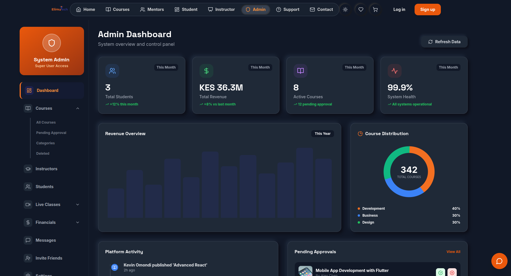
</a>

<h3><a href="https://github.com/mastermind-creat/elimu-tech-lms">A Scalable Learning Ecosystem</a></h3>

<p align="center">


</p>

</div>

Full-stack LMS digitizing education for institutions — modular course builders, automated assessment engines, and analytics dashboards.

- ✅ Multi-tenant SaaS architecture
- ✅ Real-time progress tracking
- ✅ Automated grading &amp; certification
- ✅ RESTful API with JWT authentication

<p align="center"></p>

<p align="center"><a href="https://github.com/mastermind-creat/elimu-tech-lms"></a></p>

</td>
<td width="50%" valign="top">

<div align="center">


<a href="https://github.com/mastermind-creat/snapaura">
  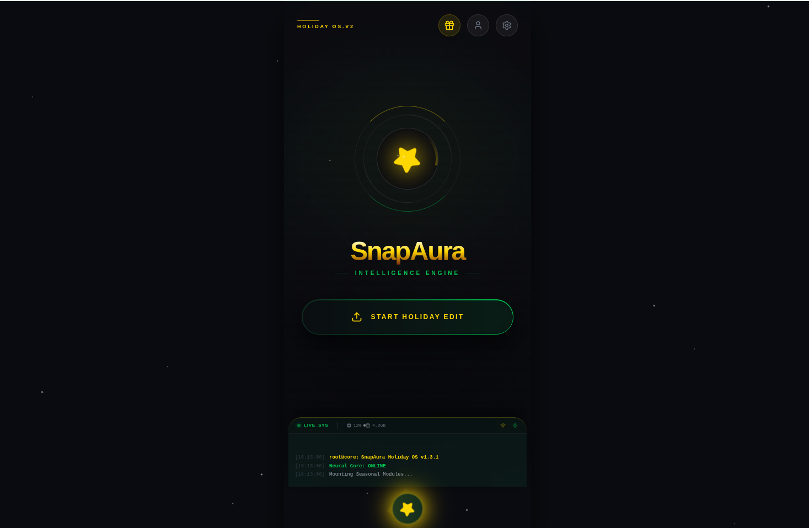
</a>

<h3><a href="https://github.com/mastermind-creat/snapaura">Intelligent Content Delivery Platform</a></h3>

<p align="center">


</p>

</div>

High-performance platform for dynamic media and content — smart caching, responsive UI patterns, and a decoupled architecture.

- ✅ Lazy-loading &amp; progressive enhancement
- ✅ CDN-optimized asset delivery
- ✅ Component-based design system
- ✅ API-first architecture

<p align="center"></p>

<p align="center"><a href="https://github.com/mastermind-creat/snapaura"></a></p>

</td>
</tr>
<tr>
<td width="50%" valign="top">

<div align="center">


<a href="https://github.com/mastermind-creat/pageforge">
  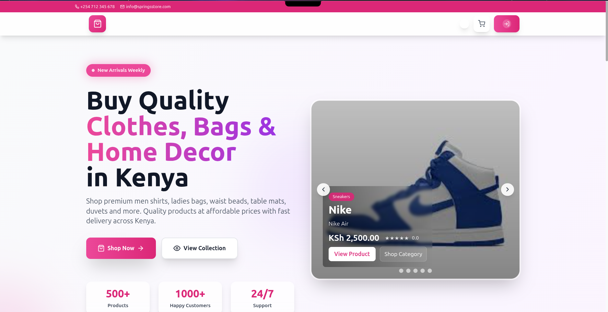
</a>

<h3><a href="https://github.com/mastermind-creat/pageforge">Rapid Landing Page System</a></h3>

<p align="center">


</p>

</div>

Developer-friendly page builder emphasizing performance and design consistency — rapid deployment of SEO-optimized landing pages.

- ✅ Component library with pre-built blocks
- ✅ Zero-config deployment pipeline
- ✅ Built-in SEO &amp; performance optimization
- ✅ Version control for design iterations

<p align="center"></p>

<p align="center"><a href="https://github.com/mastermind-creat/pageforge"></a></p>

</td>
<td width="50%" valign="top">

<div align="center">


<a href="https://github.com/mastermind-creat/launchverse">
  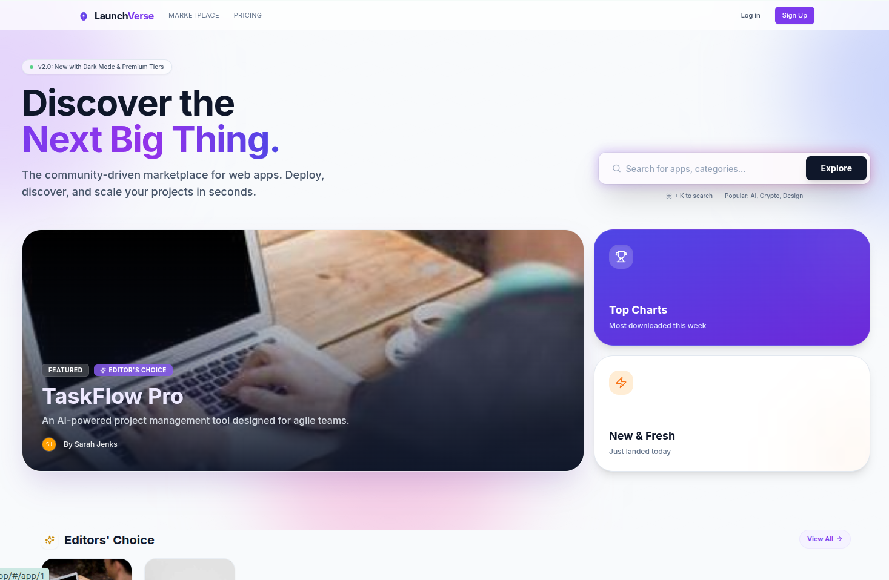
</a>

<h3><a href="https://github.com/mastermind-creat/launchverse">Product Launch Orchestrator</a></h3>

<p align="center">


</p>

</div>

Integrated platform to manage product launches — from waitlist and hype-building to post-launch analytics and community engagement.

- ✅ Multi-channel campaign automation
- ✅ Real-time analytics dashboard
- ✅ Community engagement tools
- ✅ A/B testing framework

<p align="center"></p>

<p align="center"><a href="https://github.com/mastermind-creat/launchverse"></a></p>

</td>
</tr>
<tr>
<td width="100%" colspan="2" valign="top">

<div align="center">


<a href="https://sokomtaa.co.ke">
  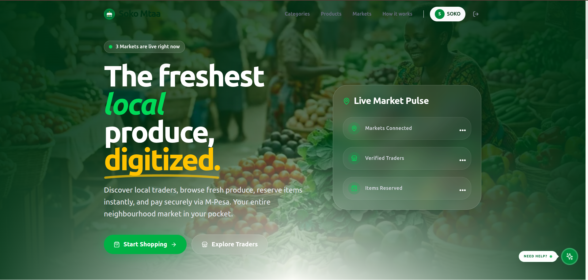
</a>

<h3><a href="https://sokomtaa.co.ke">AI Marketplace for Neighbourhoods</a></h3>

<p align="center">


</p>

</div>

AI-powered neighbourhood marketplace connecting local businesses, services, and residents with real-time recommendations and intelligent search.

- ✅ AI-powered personalized recommendations
- ✅ Neighbourhood-scoped localized marketplace
- ✅ Real-time listings &amp; dynamic inventory
- ✅ Modular full-stack API architecture

<p align="center"></p>

<p align="center"><a href="https://sokomtaa.co.ke"></a></p>

</td>
</tr>
</table>

</div>

<details>
<summary><b>▸ Expand the full project matrix</b></summary>

<br/>

| Project | Purpose | Tech Stack | Impact Metric |
|---------|---------|------------|---------------|
| Ajira Digital Club System | Membership &amp; event management for tech communities | Laravel, MySQL | 500+ active members |
| NGO Bursary Management | Transparent fund allocation with applicant tracking | PHP, PostgreSQL | $100K+ distributed |
| Student Result Management | Academic tracking with automated report generation | Laravel, React | 2000+ students |
| WhatsApp Automation Bots | Intelligent customer support &amp; engagement workflows | Python, Twilio API | 90% response automation |
| Memoria | Browser-based cognitive training game | JavaScript, LocalStorage | 5K+ gameplay sessions |
| Gameverse | Gamers arena — browser-based multi-game collection &amp; gaming ecosystem | JavaScript, React, Canvas API | Live at [epldls.vercel.app](https://epldls.vercel.app) |

</details>

<!-- ▓▓▓ ARCHITECTURE ▓▓▓ -->
<a id="architecture" name="architecture"></a>
<div align="center">

</div>

<p align="center"><sub><code>HOW THE LAYERS CONNECT · CLIENT → API → DATA → AI</code></sub></p>

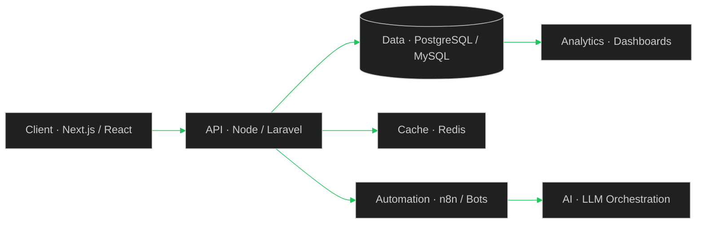

<!-- ▓▓▓ CASE STUDIES ▓▓▓ -->
<a id="case-studies" name="case-studies"></a>
<details>
<summary><b>▸ Case studies: how the systems were built</b></summary>

<br/>

**01 · Elimu Tech LMS — Multi-tenant education platform**
- **Problem:** Institutions needed one system for course delivery, assessment, and certification.
- **Architecture:** Modular course builder, automated grading engine, JWT-secured REST API, tenant-isolated data model.
- **Result:** Digitized course delivery and automated certification across institutions.

**02 · Sokomtaa — AI neighbourhood marketplace**
- **Problem:** Local commerce was fragmented and discovery was poor.
- **Architecture:** Next.js + Node + PostgreSQL, AI recommendations, neighbourhood-scoped indexing, real-time listings.
- **Result:** Shipped as a live, production AI marketplace.

**03 · Automation &amp; Ops — Removing manual toil**
- **Problem:** Repetitive support and reporting work consumed team time.
- **Architecture:** Python services + Twilio + n8n workflows with API integrations.
- **Result:** 90% response automation and 20+ hours/week saved.

</details>

<!-- ▓▓▓ TECH RADAR ▓▓▓ -->
<a id="stack" name="stack"></a>
<div align="center">

</div>

<div align="center">


<br/>

<table>
<tr>
<td width="50%" valign="top" align="center">


<br/>


</td>
<td width="50%" valign="top" align="center">


<br/>


</td>
</tr>
<tr>
<td width="50%" valign="top" align="center">


<br/>


</td>
<td width="50%" valign="top" align="center">


<br/>


</td>
</tr>
</table>

</div>

<!-- ▓▓▓ ANALYTICS ▓▓▓ -->
<a id="activity" name="activity"></a>
<div align="center">

</div>

<div align="center">

<!-- Contribution Snake -->
<picture>
  <source media="(prefers-color-scheme: dark)" srcset="https://raw.githubusercontent.com/mastermind-creat/mastermind-creat/output/github-contribution-grid-snake-dark.svg">
  <source media="(prefers-color-scheme: light)" srcset="https://raw.githubusercontent.com/mastermind-creat/mastermind-creat/output/github-contribution-grid-snake.svg">
  
</picture>

<br/><br/>


<br/>

<a href="https://github.com/mastermind-creat">
  
</a>
<a href="https://github.com/mastermind-creat">
  
</a>

<br/><br/>

<a href="https://git.io/streak-stats">
  
</a>

<br/><br/>

<details>
<summary><b>▸ Reveal trophy cabinet</b></summary>

<br/>


</details>

</div>

<!-- ▓▓▓ ROADMAP ▓▓▓ -->
<div align="center">

</div>

<div align="center">


</div>

<!-- ▓▓▓ PRIORITIES ▓▓▓ -->
<div align="center">

</div>

<table>
<tr>
<td width="50%" valign="top">

**🎯 Technical Mastery**
- Advanced React patterns (Suspense, Concurrent)
- LLM integration &amp; prompt engineering
- Microservices with event-driven architecture
- Performance optimization at scale

</td>
<td width="50%" valign="top">

**🌍 Impact Initiatives**
- Personal AI assistant ecosystem
- Education platform expansion (Elimu Tech)
- NGO digital transformation toolkit
- Open-source automation frameworks

</td>
</tr>
</table>

<!-- ▓▓▓ CREDENTIALS ▓▓▓ -->
<a id="credentials" name="credentials"></a>
<div align="center">

<h3>🎖️ Credentials &amp; Recognition</h3>


<br/>

<sub><code>CURRENTLY LEVELING UP · LLM ORCHESTRATION · EVENT-DRIVEN MICROSERVICES · REACT SUSPENSE/CONCURRENT</code></sub>

</div>

<!-- ▓▓▓ ETHOS ▓▓▓ -->
<div align="center">

</div>

<div align="center">


<br/>

**MASTERMINDCREAT is more than a brand — it's a build philosophy.**

- **Intelligent by Design** → AI-first thinking
- **Scalable by Architecture** → Built for growth
- **Valuable by Impact** → Measured results

Every line of code serves the larger vision of a more automated, efficient, and human-centric world.

</div>

<details>
<summary><b>▸ Read testimonials &amp; recommendations</b></summary>

<br/>

<div align="center">

<table>
<tr>
<td width="50%" align="center">


<br/>

> *"Wambia's systems thinking approach transformed our entire platform architecture. His ability to see the big picture while managing intricate details is exceptional."*

**— Education Institution Director**

</td>
<td width="50%" align="center">


<br/>

> *"One of the most innovative engineers I've worked with. He doesn't just build features — he architects solutions that scale and evolve."*

**— Senior Full-Stack Developer**

</td>
</tr>
<tr>
<td width="50%" align="center">


<br/>

> *"The automation workflows Wambia built saved our team 20+ hours per week. His work directly impacted our bottom line."*

**— NGO Operations Manager**

</td>
<td width="50%" align="center">


<br/>

> *"Clean code, excellent documentation, and a genuine passion for solving real problems. A true systems engineer."*

**— Tech Lead, Startup**

</td>
</tr>
</table>

</div>

</details>

<!-- ▓▓▓ STATUS ▓▓▓ -->
<div align="center">

</div>

<div align="center">

```typescript
const MASTERMIND_STATE = {
  activeProject:  "AI-Driven SaaS Ecosystem",
  researchPhase:  "Distributed Microservices & LLM Orchestration",
  consulting:     "NGO Digital Transformation & LMS Strategy",
  efficiency:     "Automating 90% of repeatable digital workflows",
  focus:          "Scaling impact-first digital solutions globally",
};
```

<p align="center"><sub><code>LAST SYNC · NOVEMBER 2026</code></sub></p>

</div>

<!-- ▓▓▓ WRITING ▓▓▓ -->
<a id="writing" name="writing"></a>
<div align="center">

<h3>✍️ Writing &amp; Speaking</h3>

<sub><code>NOTES ON SYSTEMS, AI, AND AUTOMATION</code></sub>

<br/>

<a href="https://www.youtube.com/@kennyleyy3918"></a>
<a href="https://x.com/MastermindCreat"></a>
<a href="https://github.com/mastermind-creat"></a>

<br/>

Sharing build logs, architecture breakdowns, and lessons from shipping impact-first systems.

</div>

<!-- ▓▓▓ CONNECT ▓▓▓ -->
<a id="connect" name="connect"></a>
<div align="center">

</div>

<div align="center">

I am actively seeking collaborations, advisory roles, and challenging problems that sit at the intersection of **systems engineering, automation, and social impact**.

**Let's build systems that matter.**

<sub><code>KISUMU, KENYA · EAT (UTC+3) · REPLIES WITHIN 24–48H · OPEN TO COLLABORATION &amp; ADVISORY</code></sub>

<br/>

<a href="mailto:kennyleyy0@gmail.com?subject=Project%20Inquiry%20%E2%80%94%20Let%27s%20Build"></a>
<a href="mailto:kennyleyy0@gmail.com?subject=Discovery%20Call%20Request"></a>
<a href="https://www.linkedin.com/in/mastermind-5799bb398"></a>
<a href="https://wk-three.vercel.app/"></a>

<br/>


<br/>


</div>

<details>
<summary><b>▸ Open the design gallery</b></summary>

<br/>

<div align="center">

<table>
<tr>
<td width="33%">
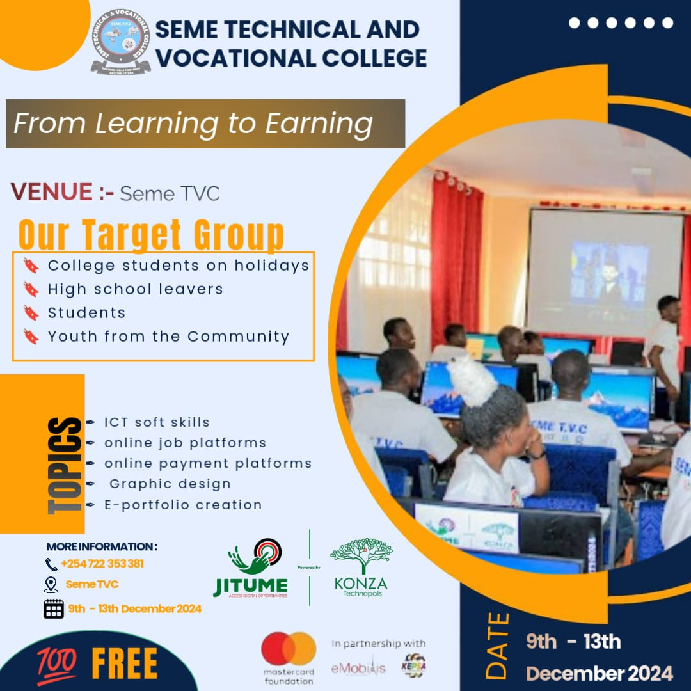
<p align="center"><b>Branding &amp; Identity</b></p>
</td>
<td width="33%">
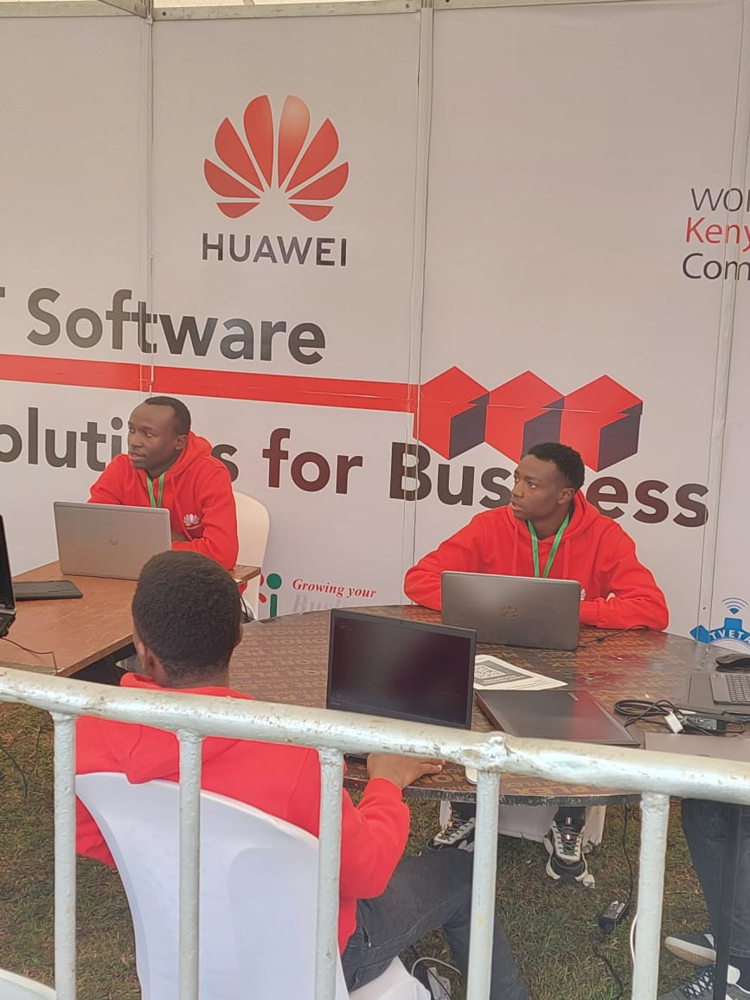
<p align="center"><b>Digital Illustration</b></p>
</td>
<td width="33%">

<p align="center"><b>UI/UX Concepts</b></p>
</td>
</tr>
<tr>
<td width="33%">
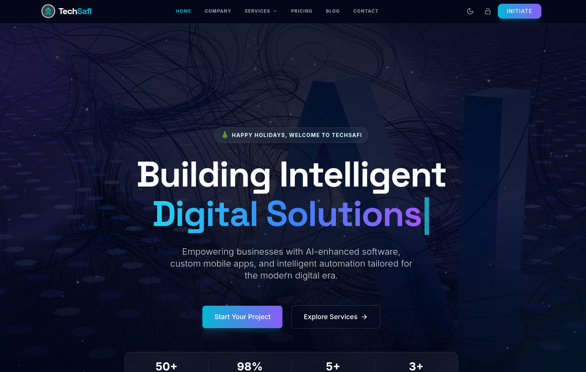
<p align="center"><b>Web Portals</b></p>
</td>
<td width="33%">

<p align="center"><b>Community Systems</b></p>
</td>
<td width="33%">
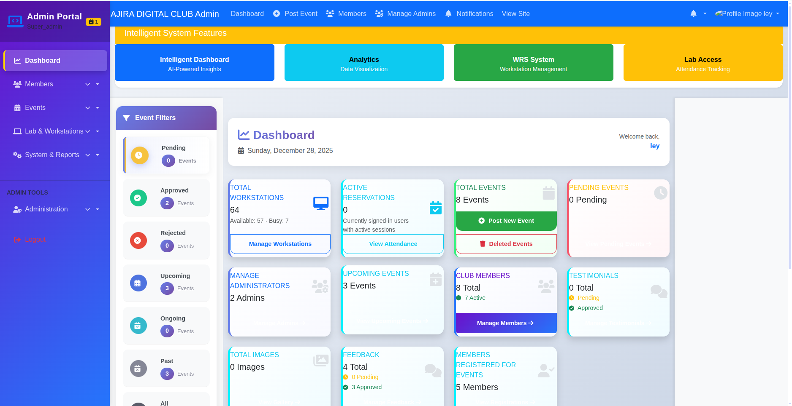
<p align="center"><b>Mobile Experiences</b></p>
</td>
</tr>
</table>

<br/>

<a href="https://github.com/mastermind-creat?tab=repositories">
  
</a>

</div>

</details>

<br/>

<div align="center">
  <sub>Crafted with precision for systems that scale. &nbsp; </sub>
</div>

<!-- HUD footer scan-line -->


